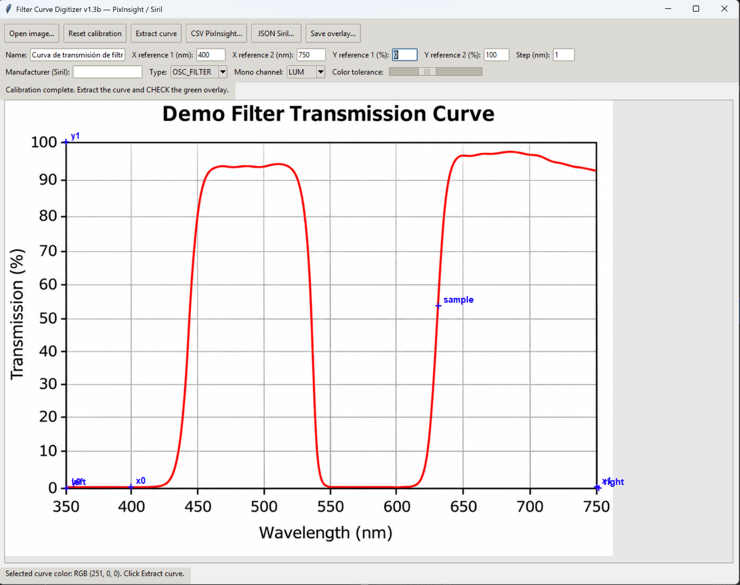
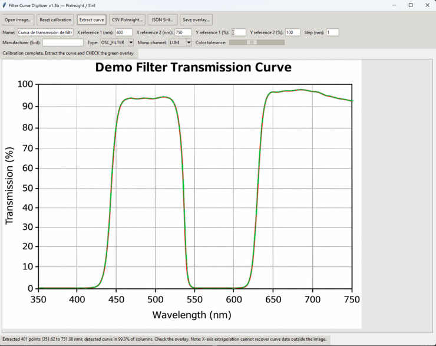

# Filter Curve Digitizer

**Version 1.3b · Windows x64, macOS and Linux x86_64 builds · Python source**

Filter Curve Digitizer converts a **color-coded spectral transmission curve in an image** into wavelength/transmission samples. It exports a CSV definition for **PixInsight FilterManager** and a JSON definition intended for **Siril's SPCC filter database**.

Developed by **Carlos Rincón**. Inspired by the filter digitization workflow shared by Sweetman Astrophotography.

> **Status:** The Windows executable and CSV/JSON file generation have been tested with an Astronomik CLS transmission chart. The Siril JSON has **not yet been verified by importing it into Siril**. This is a digitization utility, not a spectrophotometer; extracted values are approximations of the source graphic.

## Security notice

> [!IMPORTANT]
> **Unsigned applications (Windows and macOS)**
>
> Filter Curve Digitizer is currently distributed without developer code signing or Apple notarization. On first launch, the operating system may warn that the developer cannot be verified or that the publisher is unknown. This warning does not by itself indicate malware, but the software's origin has not been authenticated through the operating system's signing process.
>
> **Only continue if you trust the source and downloaded the application from this project's GitHub repository.**
>
> **macOS:** First try opening `Filter Curve Digitizer.app`. If blocked, open **System Settings → Privacy & Security** and look for **Open Anyway** near the blocked app notice. Confirm the prompt. The wording and availability depend on your macOS version. Do not disable Gatekeeper globally.
>
> **Windows:** SmartScreen may report an unknown publisher. Verify the download before deciding whether to proceed; do not disable SmartScreen globally.

## Contents

- [Security notice](#security-notice)
- [Download and installation](#download-and-installation)
- [Quick start: the seven clicks](#quick-start-the-seven-clicks)
- [Understanding calibration](#understanding-calibration)
- [Controls and prompts](#controls-and-prompts)
- [Example: Astronomik CLS](#example-astronomik-cls)
- [Checking extraction quality](#checking-extraction-quality)
- [Exporting to PixInsight](#exporting-to-pixinsight)
- [Exporting to Siril](#exporting-to-siril)
- [Troubleshooting](#troubleshooting)
- [Limitations and data quality](#limitations-and-data-quality)
- [Building the Windows executable](#building-the-windows-executable)
- [Credits, license and changelog](#credits-license-and-changelog)

## Download and installation

### Windows (64-bit)

The compiled executable is currently available to repository collaborators through **GitHub Actions**. A public release download is **not available yet**.

1. Open **Actions → Build Windows EXE (Nuitka)** in this repository.
2. Open a **successful** build from the current version.
3. Under **Artifacts**, download `Filter-Curve-Digitizer-Windows-x64`.
4. Unzip the artifact and run `Filter_Curve_Digitizer.exe`.

The one-file executable bundles the Python runtime and required modules: Python does not need to be installed separately on the Windows computer. Windows SmartScreen may display a warning for an unsigned executable. Run only software obtained from a source you trust; this application is not digitally signed.

**Note:** GitHub Actions artifacts are temporary (configured retention: 14 days). A future release may offer versioned downloads through GitHub Releases.

### macOS Intel (x86_64)

The Intel `Filter Curve Digitizer.app` build has been opened successfully on an Intel Mac. A public macOS download is not available yet.

1. Open **Actions → Build macOS Intel APP (PyInstaller)** and choose a successful run.
2. Download artifact `Filter-Curve-Digitizer-macOS-Intel-v1.3b`.
3. Unzip the downloaded GitHub Actions artifact: it contains **another ZIP** with the packaged application.
4. Extract the inner ZIP to obtain `Filter Curve Digitizer.app`. If double-click extraction fails, select **Open With → Archive Utility**.
5. Open the `.app`. If macOS blocks the first launch, see the **Security notice** above.

This build targets **Intel (x86_64)**, not Apple Silicon (arm64). The app is not signed or notarized.

### Linux x86_64 — BETA (limited testing)

The Linux build is distributed as a **complete application directory** inside a `.tar.gz` archive (currently available as a GitHub Actions artifact, pending final validation and public release).

> [!WARNING]
> **Do not move or run the executable by itself.** The `Filter_Curve_Digitizer` executable **must stay in the same directory as `_internal/`**. That folder contains the bundled Python runtime, Pillow/Tk support and other required libraries. If they are separated, the application will fail with a missing `libpython3.11.so.1.0` error.

1. Download the latest successful **Build Linux x86_64 APP (PyInstaller)** artifact from GitHub Actions.
2. Unzip the Actions download (outer ZIP), then **extract the complete inner `.tar.gz`**. You should get this structure:

```text
Filter_Curve_Digitizer/
├── Filter_Curve_Digitizer    # executable
└── _internal/               # keep this entire folder!
```

3. Keep both items together and move the **whole `Filter_Curve_Digitizer` folder** wherever you want, such as your home directory.
4. Open a terminal in the parent directory and run:

```bash
./Filter_Curve_Digitizer/Filter_Curve_Digitizer
```

For a diagnostic check, run `./Filter_Curve_Digitizer/Filter_Curve_Digitizer --self-test` instead. It should briefly show a red test image, report the result in the terminal, and exit.

**Status: BETA (Linux x86_64).** This is an early platform build with limited testing. It is not yet verified on a native Linux installation or other distributions.

**Tests completed on 20 November 2026:** Ubuntu 26.04.1 LTS x86_64 running as a Parallels virtual machine on an Intel Mac:
- Packaged application launches, and its Pillow/Tk image-rendering self-test displays a red image.
- Opens and displays a local image; seven-point calibration and curve extraction run successfully.
- Visual inspection shows the green extracted overlay following the source curve.
- Produces a readable PixInsight FilterManager CSV and a structurally valid Siril JSON with numeric wavelength/transmission arrays. These two supplied exports have slightly different wavelength ranges/sample counts, so they have **not** been verified as identical datasets.
- Reads an image from a macOS shared folder using its full path.

**Not tested:** native Linux hardware; other Linux distributions and desktop environments; installation/launch outside the tested Ubuntu/Parallels environment; actual CSV import into PixInsight; actual JSON import into Siril; broad compatibility or regression testing. In Parallels, the Tk file dialog may not navigate shared macOS folders conveniently, although entering a full path works. This VM-specific behavior is not established as a defect on native Linux.

**Build environment:** Ubuntu 22.04 x86_64. Python does not need to be installed separately for the packaged application.

### Run from Python source (Windows, macOS or Linux)

Requirements: Python with a working **Tkinter** installation, **NumPy**, and **Pillow**.

```bash
python3 -m pip install -r requirements.txt
python3 Filter_Curve_Digitizer.py
```

On Windows, use `py` or `python` in place of `python3` if appropriate. On macOS, some system Python builds include an old or unsuitable Tkinter; use a Python installation with working Tk support. A separate standalone Intel macOS `.app` is available as a private GitHub Actions artifact.

Supported input file types: PNG, JPEG, WEBP, BMP, and TIFF.

## Quick start: the seven clicks

1. Click **Open image…** and select a transmission plot.
2. Set **X reference 1 (nm)** and **X reference 2 (nm)** to two *labeled wavelength ticks* you can identify unambiguously, for example **400** and **700**. Set **Y reference 1 (%)** and **Y reference 2 (%)**, usually **0** and **100**. Set **Step (nm)**, typically **1**.
3. Follow the seven prompts and click on the image **in this exact order**:

| Click | On-screen prompt | What to click |
| --- | --- | --- |
| 1 | `Click exactly on the X-axis tick corresponding to X Reference 1.` | The **400 nm** tick if X reference 1 = 400. |
| 2 | `Click exactly on the X-axis tick corresponding to X Reference 2.` | The **700 nm** tick if X reference 2 = 700. |
| 3 | `Click on the Y-axis tick corresponding to Y Reference 1.` | The **0%** line/tick if Y reference 1 = 0. |
| 4 | `Click on the Y-axis tick corresponding to Y Reference 2.` | The **100%** line/tick if Y reference 2 = 100. |
| 5 | `Click the LEFT boundary of the plot area to digitize.` | Left edge of the **actual plotted data area**, which can be left of the 400 nm reference. |
| 6 | `Click the RIGHT boundary of the plot area to digitize.` | Right edge of the plotted data area, even if it differs from reference 2. |
| 7 | `Click the transmission curve to sample its color.` | A clear, saturated part of the **target curve**, not a grid line, text, or secondary plotted curve. |

4. Click **Extract curve**.
5. **Inspect the continuous green line** over the original curve. If it follows the wrong line, reset and try again, or adjust **Color tolerance** and extract again.
6. Click **CSV PixInsight…**, **JSON Siril…**, and/or **Save overlay…**.

**Important:** X reference values are calibration markers, **not** the start/end of the export. Clicks 5 and 6 independently delimit the portion of the image to digitize.

### Visual walkthrough

The example below uses an **original demonstration transmission plot**, created for this project. It does not reproduce a manufacturer's published chart.

**Step 1 — Calibrate the plot and select the curve.** The screenshot shows the X-axis reference ticks (400 and 750 nm), the Y-axis references (0% and 100%), the left and right plot boundaries, and the sampled red curve. The blue marks indicate the calibration clicks.



**Step 2 — Extract and inspect the result.** The continuous **green line** follows the original **red transmission curve**. Compare the rising and falling edges, passband plateaus, and baseline before exporting.



These screenshots demonstrate the Windows v1.3b interface. The illustrated filter is **synthetic** and its shape is for software testing and instruction, not a commercial filter specification.


## Understanding calibration

The horizontal axis is assumed to be **linear in wavelength**. Two known tick positions let the application convert every horizontal pixel position to wavelength:

```text
wavelength(x) = reference1_nm
              + (x - reference1_pixel)
              * (reference2_nm - reference1_nm)
              / (reference2_pixel - reference1_pixel)
```

For example, you may click the 400 nm and 700 nm ticks to establish the scale, then set the plot's left boundary at approximately 360 nm. The application **extrapolates the X scale** from the reference ticks, and samples the visible graph over the selected width.

The two Y reference clicks similarly map vertical pixel positions to transmission percentages; they need not be at the same X position as the wavelength reference clicks.

**Extrapolating an axis does not create missing data.** The graph must actually contain the curve within the chosen boundaries. The program cannot infer transmission beyond the image.

For best results, click the center of each tick/line accurately. Reference ticks should be sufficiently far apart (the program requires at least 50 source-image pixels between the X references and between the Y references).

## Controls and prompts

| Control | Purpose |
| --- | --- |
| **Open image…** | Load a source graph; resets calibration. |
| **Reset calibration** | Clear the seven clicks and start again. |
| **Extract curve** | Trace matching colored pixels and calculate transmission samples. |
| **CSV PixInsight…** | Save a PixInsight FilterManager CSV definition. |
| **JSON Siril…** | Save a JSON filter definition intended for Siril SPCC. |
| **Save overlay…** | Save the source image with the extracted curve drawn in green. |
| **Name** | Filter name included in exported files. Initially taken from the image filename. |
| **X reference 1 / 2 (nm)** | Wavelength values of the first two X ticks clicked; not export bounds. |
| **Y reference 1 / 2 (%)** | Transmission percentages of the Y ticks clicked. |
| **Step (nm)** | Approximate spectral spacing of exported samples, typically 1 nm. The exact visible end point may be included as one extra sample. |
| **Manufacturer (Siril)** | Manufacturer metadata for the JSON file. |
| **Type** | `OSC_FILTER` or `MONO_FILTER` for the JSON metadata. |
| **Mono channel** | `LUM`, `RED`, `GREEN`, or `BLUE` when type is `MONO_FILTER`. |
| **Color tolerance** | How far pixel colors may differ from the sampled curve color. Lower is stricter; higher is more permissive. |

After the seventh click, the application prompts you to extract the curve and **check the green overlay**. The status line reports the wavelength interval, number of exported points, and proportion of image columns in which matching colored pixels were detected. The detection percentage is **not** a scientific accuracy score.

## Example: Astronomik CLS

A worked example using an Astronomik CLS manufacturer's transmission graphic:

- **X reference 1:** `400` nm; click its tick.
- **X reference 2:** `700` nm; click its tick.
- **Y reference 1:** `0`%; click the baseline.
- **Y reference 2:** `100`%; click the upper horizontal reference.
- **Step:** `1` nm.
- **Left plot boundary:** the left edge of the visible axes (approximately 360 nm on this image).
- **Right plot boundary:** the right edge (approximately 700 nm on this image).
- **Color sample:** a red part of the transmission line.

Click **Extract curve** and compare the green overlay with the red line. On the example tested, the first high-transmission band is around **450–540 nm**, while the second rises near **635–640 nm** and continues to the right edge of the chart. These are approximate readings of that particular image, not certified filter specifications.

The image has other colored lines marking spectral references: make sure you select the **red transmission curve**. Save the overlay for review before exporting.

## Checking extraction quality

The extraction searches the selected plot area for pixels similar in color to the sampled curve. If some columns have no matching pixels, short gaps can be interpolated; larger gaps are handled as low/zero transmission. This makes **visual verification essential**.

Check especially:

- Rising and falling edges of each passband.
- Peaks, plateaus, and narrow notches.
- Regions close to the zero-transmission baseline.
- Crossings with grid lines, labels or other colored curves.
- The left and right borders of the selected plot.

The green overlay is **three pixels wide** in the source image. Use **Save overlay…** if you want to share the verification image.

Do **not** assume that a high detected-column percentage means the spectrum is accurate.

## Exporting to PixInsight

1. After verifying the overlay, click **CSV PixInsight…**.
2. Save the file (default prefix `FilterManager_`).
3. In **PixInsight**, open **FilterManager** and use **Merge CSV filter definitions**.
4. Check that the imported filter name and spectral response are correct before using it for color calibration.

The generated CSV contains the records `type`, `name`, `channel`, `wavelength` and `transmission`. Transmission is a normalized fraction **0–1**, not a percentage 0–100. The filter is written as `channel,L` by this version.

**Validation status:** CSV export has been tested; verify the import and intended behavior in your installed PixInsight version.

## Exporting to Siril

1. Set the **Manufacturer**, **Type**, and (if relevant) **Mono channel**.
2. After verifying the overlay, click **JSON Siril…**.
3. Save the file (default prefix `Siril_`).
4. The JSON is a **filter definition intended for Siril's local SPCC filter database**. It is **not an automatic importer**. Follow Siril's documentation for your installed version to determine whether/how a custom filter definition can be added, then verify that Siril recognizes it.

The JSON contains the filter name/model, type, quality and source metadata, wavelengths in **nm**, and normalized transmission values **0–1**.

**Important:** The JSON's structure and values have been checked, but **successful import into Siril has not yet been demonstrated**. Do not assume interoperability until tested. For narrowband or multiband filters, consider whether Siril's dedicated narrowband calibration workflow is more appropriate.

## Troubleshooting

**The X positions or passbands are shifted.**  
Make sure X reference 1/2 match the **actual ticks you click** (for example 400/700). The first two clicks are **not** the plot boundaries. Set the visible plot edges separately in clicks 5/6. Reset calibration after any ambiguous click.

**My curve starts/ends too early.**  
Review plot boundary clicks 5 and 6; they govern the export interval. Extrapolation is valid only over image content that exists.

**I see a sharp transmission drop at the edge.**  
Make sure you selected the real plot edge, not an area beyond the plotted curve. Review the overlay at the edge; never interpret an image/extraction artifact as a real optical cutoff.

**Wrong line detected, or the curve looks noisy.**  
Click a saturated portion of the correct line. Lower **Color tolerance**, avoid intersecting colored grid/reference lines, or use a cleaner/cropped source chart. You can re-extract after adjusting tolerance; to choose a different curve color, reset the calibration.

**Not enough curve pixels detected.**  
Confirm the seventh click selected a visibly colored line. Increase tolerance moderately or try a higher-resolution source image.

**The image contains multiple similarly colored curves.**  
The current algorithm selects pixels by color and cannot reliably distinguish overlapping curves of the same color. Crop, isolate or clean the target line before importing the image.

**Nothing happens when I try to export.**  
You must first complete the seven clicks and click **Extract curve**. If the extraction reports an error, resolve it before exporting.

**The program does not start from Python.**  
Check the Python installation, Tkinter support, and install dependencies with `python3 -m pip install -r requirements.txt`.

**Windows warns about an unknown publisher.**  
The executable is unsigned. Confirm its source before running it.

## Limitations and data quality

- The tool digitizes **published curves in images**. It does not measure the filter itself.
- The source graph is assumed to have **linear wavelength and transmission axes**, with correct axes/tick labels.
- The tracing algorithm relies on color separation; antialiasing, compression, background patterns and crossings can affect results.
- It does not reconstruct an invisible or cropped portion of a curve.
- Strongly overlapping curves or grayscale plots may require manual image cleanup.
- Absolute wavelength precision depends on the image resolution and the user's reference clicks.
- Nonzero residuals near 0% transmission may be graphic/digitization artifacts; this version does not automatically remove weak values.
- Output arrays are **digitized approximations**, not independently validated manufacturer measurement tables.
- The JSON compatibility with Siril requires an actual import test.

Please keep source attribution to the manufacturer when sharing digitized data, and respect the copyright/license of the original chart.

## Building the Windows executable

The private repository contains `.github/workflows/windows-exe.yml`. It uses **GitHub Actions, Windows x64, Python 3.12 and Nuitka** to compile a one-file GUI executable, using `Filter_Curve_Digitizer.ico` as the Windows icon.

To create a new build, open **Actions → Build Windows EXE (Nuitka) → Run workflow** and select the correct branch. New pushes to the script, icon, requirements, or workflow can also trigger builds. The resulting ZIP is under **Artifacts** on a successful run. Artifacts are temporary; source commits remain available.

The Windows build is **not** a public GitHub Release. An Intel macOS `.app` build is available privately through GitHub Actions.

## Credits, license and changelog

**Developer:** Carlos Rincón · [crinconlab](https://github.com/crinconlab)

**Acknowledgment:** Inspired by the original filter digitization script/workflow shared by **Sweetman Astrophotography**. This application is an independently developed implementation. Attribution wording may be refined before public release.

**License:** MIT; see [LICENSE](LICENSE).

### Changelog

- **v1.3b:** English-language user interface; seven-step calibration with independent plot boundaries; continuous 3-pixel green verification overlay; Windows EXE icon support.
- **v1.3 (test):** Separate wavelength reference ticks from the visible plot export range, enabling X-axis interpolation/extrapolation over visible data.
- **v1.2:** CSV output for PixInsight FilterManager and JSON output intended for Siril SPCC.

**Publication status:** This repository is currently private. Public download pages, release packages, and wider distribution are deferred until the project is ready.
